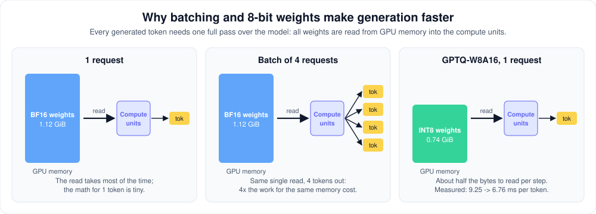
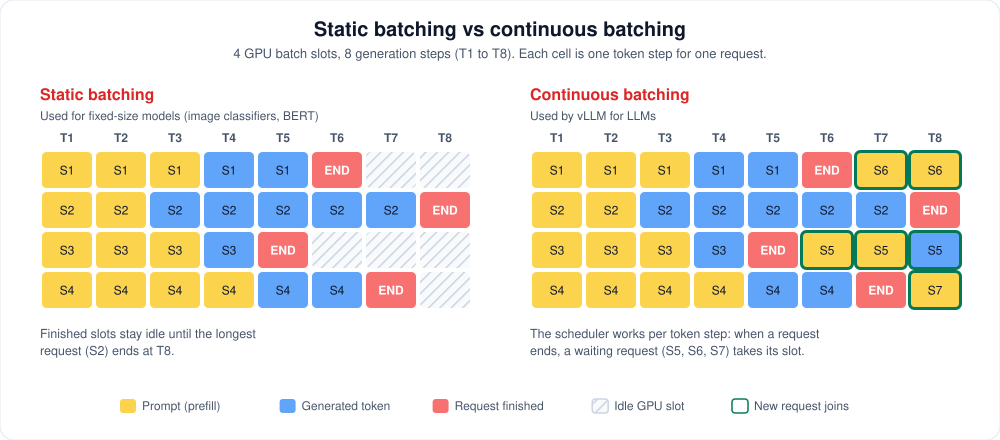
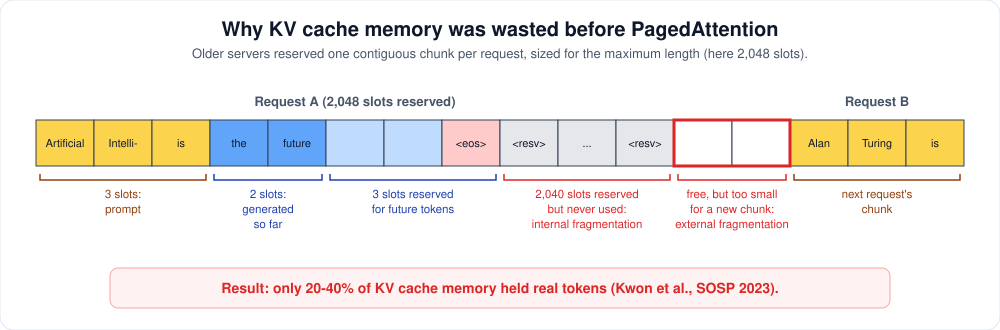
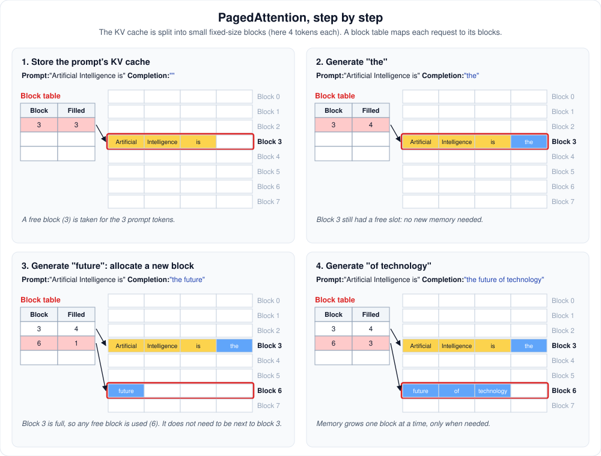
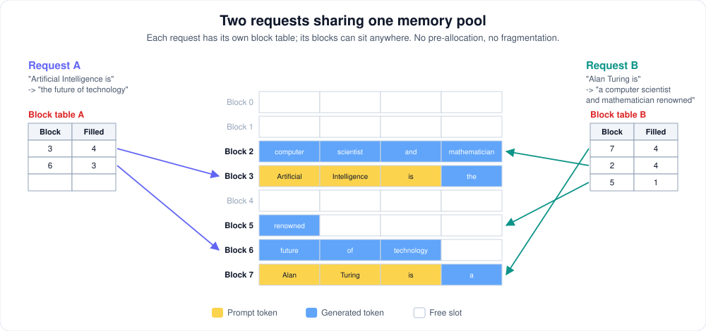
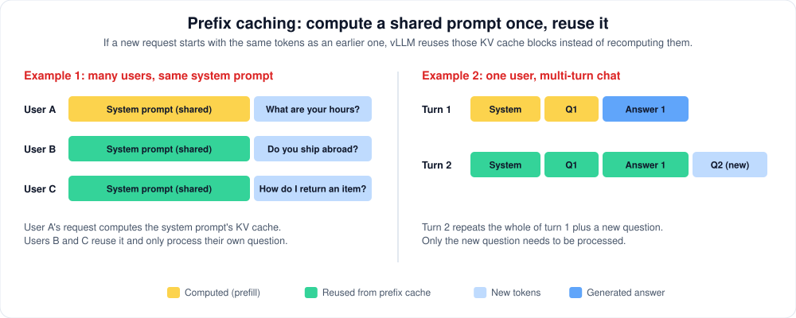
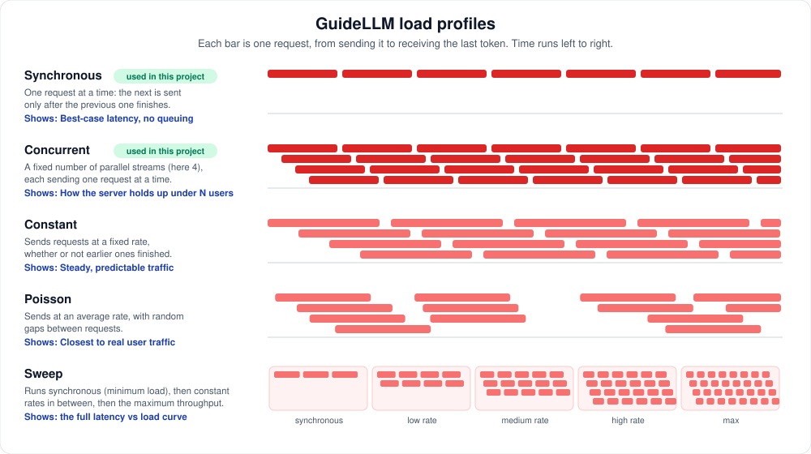
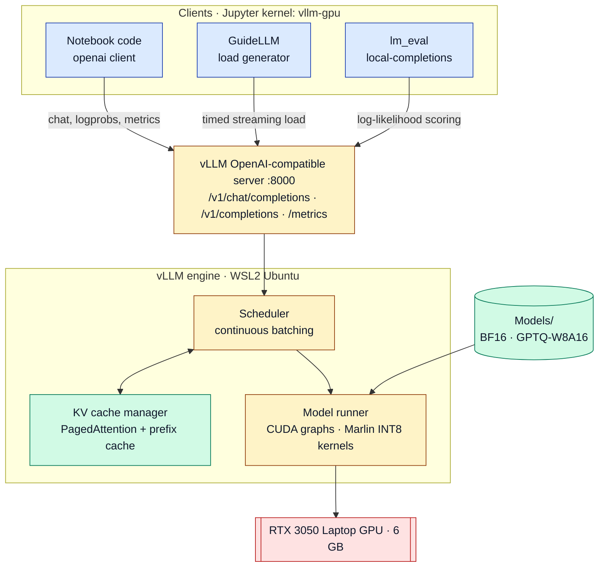

# Serving, Benchmarking and Evaluating Qwen3-0.6B with vLLM

Serve **Qwen3-0.6B** and its **GPTQ-W8A16** quantized version with [vLLM](https://github.com/vllm-project/vllm) on a laptop GPU (RTX 3050, 6 GB), then measure both versions on two questions:

- **Speed:** how fast is it, and how much load can it take? Measured with [GuideLLM](https://github.com/vllm-project/guidellm).
- **Quality:** does it still give the right answers? Measured with [lm_eval](https://github.com/EleutherAI/lm-evaluation-harness).

**Headline result:** the 8-bit model is **half the size**, **up to 34% faster**, and keeps **99.8% of the original accuracy**.

| | BF16 (original) | GPTQ-W8A16 | Change |
|:--|--:|--:|--:|
| Model size on disk | 1.50 GB | 0.76 GB | **-50%** |
| Single-user speed | 104 tok/s | 140 tok/s | **+34%** |
| Time between tokens (ITL, p50) | 9.25 ms | 6.76 ms | **-27%** |
| Throughput, 16 concurrent users | 976 tok/s | 1,144 tok/s | **+17%** |
| Average accuracy (4 tasks) | 49.8% | 49.8% | -0.1 pts |
| Same answer as BF16 | – | 97.7% | |

---

## Contents

1. [What's in this repo](#whats-in-this-repo)
2. [How LLM serving works](#how-llm-serving-works)
   - [Why one request at a time wastes the GPU](#1-why-one-request-at-a-time-wastes-the-gpu)
   - [Continuous batching](#2-continuous-batching)
   - [The KV cache problem](#3-the-kv-cache-problem)
   - [PagedAttention](#4-pagedattention)
   - [Prefix caching](#5-prefix-caching)
   - [Quantization (W8A16)](#6-quantization-w8a16)
3. [How to measure a deployment](#how-to-measure-a-deployment)
   - [Speed: GuideLLM](#speed-guidellm)
   - [Quality: lm_eval](#quality-lm_eval)
4. [Architecture](#architecture)
5. [Notebook walkthrough](#notebook-walkthrough)
6. [Results](#results)
7. [Setup](#setup)
8. [Troubleshooting](#troubleshooting)
9. [References](#references)

---

## What's in this repo

```
.
├── qwen3_vllm_serving.ipynb      # Serve both models and test vLLM's features one by one
├── qwen3_benchmark_eval.ipynb    # Benchmark speed (GuideLLM) and accuracy (lm_eval), then compare
├── requirements.txt              # Python packages (install inside WSL)
├── docs/images/                  # Diagrams used in this README
├── outputs/                      # Saved results (committed)
│   ├── serving_test_results.json     # From the serving notebook
│   ├── metrics_*.json                # vLLM /metrics snapshots
│   ├── guidellm/*.json               # One GuideLLM report per model and load profile
│   ├── lm_eval/*.json                # lm_eval scores per model
│   └── benchmark_eval_results.json   # Combined speed + accuracy summary
├── Models/                       # Model weights (git-ignored, ~5 GB)
│   ├── Qwen3-0.6B/                   # Original BF16 model
│   └── Qwen3-0.6B-GPTQ-W8A16/        # 8-bit quantized model (+ other quantized variants)
└── logs/                         # vLLM server logs (git-ignored)
```

| File | What it does |
|:--|:--|
| [`qwen3_vllm_serving.ipynb`](qwen3_vllm_serving.ipynb) | Starts a vLLM server from the notebook, then tests chat requests, token probabilities, live server metrics, continuous batching, prefix caching, generation speed and thinking mode on both models. |
| [`qwen3_benchmark_eval.ipynb`](qwen3_benchmark_eval.ipynb) | Runs GuideLLM under three load levels and lm_eval on four accuracy tasks for both models, then compares speed, accuracy, recovery and answer agreement. |
| [`requirements.txt`](requirements.txt) | `vllm`, `openai`, `requests`, `guidellm`, `lm_eval[api]`, `jupyter`, `ipykernel`. |

---

## How LLM serving works

A model that fits on a GPU isn't automatically fast to serve. Many users send requests of very different lengths at the same time, and every request needs GPU memory that grows as it generates. vLLM combines three techniques to handle this: **continuous batching**, **PagedAttention** and **prefix caching**. This project also tests a fourth technique that works on the model itself: **quantization**.

### 1. Why one request at a time wastes the GPU

An LLM writes text **one token at a time**. For each new token, the GPU reads **all of the model's weights** from its memory into its compute units. For a single request, the math per token is tiny compared to that read, so the compute units spend most of their time waiting for data. Generation is **memory-bound**.

The fix is **batching**: read the weights once and use them for many requests in the same step. The memory cost stays the same, but each read produces far more tokens.

<p align="center"></p>

The third panel shows why quantization helps too: 8-bit weights halve the data read per step. In this project that took the time per token from **9.25 ms to 6.76 ms**.

### 2. Continuous batching

**Static batching** collects a fixed group of requests and runs them until *all* of them finish. That works for models with a fixed output size, such as image classifiers. LLM answers vary in length, from a 5-token "4" to a 2,000-token essay, so short requests finish early and their slots sit **idle** until the longest one ends.

**Continuous batching** schedules **at every token step**. When a request finishes, a waiting request takes its slot right away, so the batch stays full.

<p align="center"></p>

**Seen in this project:** sending 5 requests at once, `/metrics` showed all **5 running together**, and all five 60-token answers were done in 0.81 s. In GuideLLM, BF16 throughput grew from **104 tok/s** with 1 user to **976 tok/s** with 16 users.

### 3. The KV cache problem

During generation, each request stores a **key** and a **value** vector for every token it has seen, in every layer. This is the **KV cache**, and it lets the model avoid recomputing the past. It's the biggest user of GPU memory while serving, and it's hard to manage for two reasons:

- **It grows** with every generated token.
- **Its final size is unknown**, because nobody knows in advance how long the answer will be.

Older servers reserved **one contiguous chunk per request, sized for the maximum length**. That wastes memory in three ways:

<p align="center"></p>

| Waste | What happens |
|:--|:--|
| **Reserved** | Slots held for future tokens sit empty for most of the request's life, and no other request can use them. |
| **Internal fragmentation** | The request ends long before the maximum length, so most of its chunk is never used. |
| **External fragmentation** | Gaps between chunks are free but too small to fit a new request's chunk. |

Less free memory means fewer requests fit in a batch, so throughput drops even when the GPU has compute to spare.

**For Qwen3-0.6B**, each token's KV cache takes `2 (key+value) × 28 layers × 8 KV heads × 128 dims × 2 bytes = 112 KB`. A 4,096-token request needs **448 MB**.

### 4. PagedAttention

PagedAttention, the core idea behind vLLM, borrows **virtual memory paging** from operating systems. The KV cache is split into **small fixed-size blocks** (pages), and each request has a **block table** that records which physical blocks hold its tokens. The blocks can be anywhere in GPU memory.

<p align="center"></p>

1. **Store the prompt.** A free block (3) is taken for the 3 prompt tokens.
2. **Generate "the".** Block 3 still has a free slot, so no new memory is needed.
3. **Generate "future".** Block 3 is full, so any free block (6) is taken. It doesn't have to be next to block 3.
4. **Keep generating.** Tokens fill block 6. Memory grows **one block at a time, only when needed**.

To compute attention for the next token, vLLM follows the block table and reads the blocks one by one (3, then 6), so the model sees all previous tokens even though they aren't stored next to each other.

Many requests share **one memory pool** this way:

<p align="center"></p>

The only waste left is the unused part of each request's last block. That means more requests fit in memory at once, so throughput goes up.

**Seen in this project:** at startup vLLM reported room for **26,144 tokens** of KV cache with the BF16 model and **29,632** with GPTQ-W8A16. The smaller 8-bit weights leave more memory for KV blocks.

### 5. Prefix caching

Many requests **start with the same text**: a shared system prompt, few-shot examples, a RAG document, or the earlier turns of a chat. Because KV cache blocks are identified by their content, vLLM can **reuse** a block another request already computed instead of computing it again.

<p align="center"></p>

- **Across users:** the system prompt is computed once, and every later request only processes its own question.
- **Across chat turns:** turn 2 contains all of turn 1, so only the new question needs work.

This cuts **prefill** time (time to first token) and compute. The higher the cache hit rate, the bigger the saving.

**Seen in this project:** 5 questions sharing one system prompt reused **128 of 300 prompt tokens (43%)** from the cache, on both models.

### 6. Quantization (W8A16)

Quantization stores numbers with fewer bits. **GPTQ-W8A16** means:

| Part | Meaning |
|:--|:--|
| **W8** | Weights of every linear layer stored as **8-bit integers** instead of 16-bit floats, so half the size. |
| **A16** | Activations, the values flowing between layers, stay **16-bit**. |
| **GPTQ** | The method that picks the 8-bit values. It corrects rounding errors layer by layer using sample data, so accuracy stays close to the original. |
| `group_size: 128` | Each group of 128 weights has its own scale factor, for better precision. |
| `ignore: [lm_head]` | The final layer that picks the next token stays 16-bit, because it's the most sensitive to rounding. |

vLLM reads this from the model's `config.json` and automatically uses a fast 8-bit kernel (**Marlin**), so the `vllm serve` command is exactly the same for both models.

**Where the speedup comes from:**
- **Token generation (decode) is memory-bound**, so half the weight bytes means faster steps. ITL dropped by **27%**.
- **Prompt processing (prefill) is compute-bound.** W8A16 converts the weights back to 16-bit for the math, so **TTFT doesn't improve**. Formats that also quantize activations, such as W8A8, can speed up prefill as well.

---

## How to measure a deployment

Every deployment balances **accuracy, latency and cost**. Improving two of them usually costs you the third. Measuring both speed and quality shows where a deployment actually lands.

**Start with targets (SLOs).** A number only means something compared with a goal. Two typical examples:

| Use case | TTFT | ITL | End-to-end |
|:--|:--|:--|:--|
| Chatbot (must feel instant) | < 200 ms | < 50 ms | – |
| RAG assistant (users accept a short wait) | < 300 ms | < 100 ms | < 3 s |

SLOs are usually checked at a high percentile (p95 or p99), not the average.

### Speed: GuideLLM

GuideLLM sends requests to the server under a controlled load and times every request and every streamed token.

| Metric | Meaning | Better |
|:--|:--|:--|
| **TTFT** (time to first token) | Wait before the answer starts appearing. Mostly prefill time. | Lower |
| **ITL** (inter-token latency) | Gap between streamed tokens, i.e. how smooth the text appears | Lower |
| **Request latency** | Total time for one full answer | Lower |
| **Output tokens/s** | Total tokens generated per second across all users | Higher |
| **Requests/s** | Completed requests per second | Higher |

**Percentiles matter more than averages.** p50 is the typical request. p95 means only 5% of requests are slower. A big gap between the two means some users wait much longer than others.

GuideLLM can generate load in several patterns:

<p align="center"></p>

This project uses **synchronous** (the best-case latency) and **concurrent** with 4 and 16 streams (light and heavy multi-user load), with fixed-size synthetic prompts of 256 input and 128 output tokens.

### Quality: lm_eval

lm_eval runs standard benchmark tasks against the server's `/v1/completions` endpoint. For multiple-choice questions it **doesn't generate text**. It asks for the **log-probability** of each possible answer, and the most likely one counts as the model's choice. That makes scoring fast and repeatable.

```
Illustration (not a real dataset item):

Context: "She filled the kettle with water and ..."
  A) put it on the stove to boil.      log P = -8.4   <- highest: the model's choice
  B) planted it in the garden.         log P = -21.7
  C) read it a bedtime story.          log P = -24.9
  D) painted it on the wall.           log P = -19.3
```

| Task | Tests | Choices | Metric |
|:--|:--|:--:|:--|
| HellaSwag | Picking the most sensible ending to an everyday scenario | 4 | `acc_norm` |
| ARC-Easy | Grade-school science | 4 | `acc` |
| ARC-Challenge | Harder science questions | 4 | `acc_norm` |
| WinoGrande | Working out what a pronoun refers to | 2 | `acc` |

- `acc_norm` divides each answer's log-probability by its length first, so longer answers aren't unfairly penalized.
- **Recovery** = quantized score ÷ original score. About 99% or more is effectively lossless.
- **Agreement** = the share of questions where both models chose the same answer, right or wrong. This is stricter than comparing accuracy, because two models can reach the same score by getting different questions right.

> These runs are 0-shot with 1,000 questions per task (about ±1.5 points standard error). Published model cards often use few-shot prompts and full test sets, so their numbers are higher and not directly comparable. What matters here is **the difference between the two models** under identical conditions.

---

## Architecture

All tools talk to vLLM over HTTP, exactly as a real application would:



Both notebooks start and stop the server themselves with the same command you would type in a terminal:

```bash
vllm serve Models/Qwen3-0.6B --served-model-name qwen3-0.6b-bf16 --port 8000 --max-model-len 4096 --gpu-memory-utilization 0.75
```

| Option | Why |
|:--|:--|
| `--served-model-name` | Short name clients use in the `model` field |
| `--max-model-len 4096` | Caps prompt + answer length, which also caps KV cache needs per request |
| `--gpu-memory-utilization 0.75` | Share of GPU memory vLLM reserves for weights + KV cache. Windows uses part of the 6 GB, so 0.75 leaves room. |
| `--tokenizer Models/Qwen3-0.6B` | GPTQ model only: loads the identical tokenizer from the BF16 folder (see [Troubleshooting](#troubleshooting)) |

> **Serving directly from Hugging Face:** instead of a local folder, give vLLM a repository ID, for example `vllm serve Qwen/Qwen3-0.6B --max-model-len 4096`. The first run downloads weights, tokenizer and config into `~/.cache/huggingface/hub`, and later runs reuse that cache. Gated models need `export HF_TOKEN=...` first.

---

## Notebook walkthrough

Both notebooks serve **one model at a time** (to fit in 6 GB), run the same tests on each, and compare the results at the end.

```mermaid
flowchart LR
    A["Settings and<br/>helper functions"] --> B["Start vLLM<br/>BF16 model"]
    B --> C["Run tests"]
    C --> D["Stop server<br/>free GPU memory"]
    D --> E["Start vLLM<br/>GPTQ-W8A16"]
    E --> F["Run the same tests"]
    F --> G["Stop server"]
    G --> H["Compare and<br/>save to outputs/"]

    classDef setup fill:#E0E7FF,stroke:#4338CA,color:#0F172A
    classDef bf16 fill:#DBEAFE,stroke:#1E40AF,color:#0F172A
    classDef gptq fill:#D1FAE5,stroke:#047857,color:#0F172A
    classDef out fill:#FEF3C7,stroke:#92400E,color:#0F172A
    class A setup
    class B,C,D bf16
    class E,F,G gptq
    class H out
```



### `qwen3_vllm_serving.ipynb`: vLLM features, hands-on

| Step | What it does | What you learn |
|:--|:--|:--|
| 1. Settings | Model paths, port, memory and context limits | – |
| 2. Server helpers | `start_server()` runs `vllm serve` in the background, logs to `logs/`, waits for `/v1/models`; `stop_server()` frees the GPU; `read_server_stats()` reads weight memory and KV cache size from the log | How a vLLM server starts up |
| 3. Test helpers | Each test is a function, so both models get exactly the same tests | – |
| A. First request | One chat request through the `openai` client | vLLM is a drop-in OpenAI API |
| B. Token probabilities | `logprobs=True, top_logprobs=5` on "The capital of France is" | How confident the model is, and how close the 8-bit model's predictions are |
| C. Server metrics | Reads Prometheus counters from `/metrics` | Running/waiting requests, KV cache usage, token counts |
| D. Continuous batching | 5 concurrent requests while sampling `/metrics` | All 5 run together in one batch |
| E. Prefix caching | 5 questions with one shared system prompt | Prefix cache hit rate |
| F. Generation speed | 256 tokens with `ignore_eos=True`, median of 3 runs | Single-request tokens/s |
| G. Thinking mode | Streams the same question with thinking off and on | Thinking costs many more tokens |
| Quality check | Fixed-answer questions at `temperature=0` | Whether quantization changed any answers |
| Compare | Side-by-side table of all numbers, KV cache size calculation | The trade-off in one view |

### `qwen3_benchmark_eval.ipynb`: speed and accuracy

| Step | What it does |
|:--|:--|
| 1. Settings | Models, shared tokenizer, output folders; turns off progress bars |
| 2. Server helpers | Same start/stop helpers, plus `warm_up()` so startup costs don't skew results, and `atexit` cleanup so a failed cell never leaves a server holding the GPU |
| 3. GuideLLM | `run_guidellm()` runs `guidellm run` for each load profile; `summarize_guidellm()` reads TTFT, ITL, latency (p50/p95) and throughput from the JSON report |
| 4. lm_eval | `run_lm_eval()` runs four tasks with 16 parallel requests and records each question's chosen answer, to measure agreement |
| 5–6. Run | BF16 first, then GPTQ-W8A16: start server, warm up, GuideLLM × 3 profiles, lm_eval, stop |
| 7. Compare speed | Per-profile table: BF16 vs GPTQ with % change |
| 8. Compare quality | Score ± error, difference, recovery and agreement per task |
| 9. Summary | Size, speed and accuracy in one table; everything saved to `outputs/benchmark_eval_results.json` |

GuideLLM 0.8 uses `kind=...` options instead of the older `--target/--rate` flags. A synchronous run looks like this:

```bash
guidellm run \
  --backend    kind=openai_http,target=http://localhost:8000,model=qwen3-0.6b-bf16 \
  --profile    kind=synchronous \
  --constraint kind=max_requests,count=30 \
  --data       kind=synthetic_text,prompt_tokens=256,output_tokens=128 \
  --tokenizer  kind=hf_auto,model=Models/Qwen3-0.6B \
  --output     kind=json,path=outputs/guidellm/qwen3-0.6b-bf16_synchronous.json
```

For concurrent load, use `--profile kind=concurrent,streams=16`.

---

## Results

Measured on an RTX 3050 Laptop GPU (6 GB) with vLLM 0.18.0, under WSL2.

### Memory

| | BF16 | GPTQ-W8A16 |
|:--|--:|--:|
| Weights on disk | 1.50 GB | 0.76 GB |
| Weights in GPU memory | 1.12 GiB | 0.74 GiB |
| KV cache capacity | 26,144 tokens | 29,632 tokens (+13%) |

### Speed (GuideLLM, 256 input / 128 output tokens)

| Load | Metric | BF16 | GPTQ-W8A16 | Change |
|:--|:--|--:|--:|--:|
| **1 user** (synchronous) | ITL p50 | 9.25 ms | 6.76 ms | -27% |
| | Request latency p50 | 1.22 s | 0.90 s | -26% |
| | Output throughput | 104 tok/s | 140 tok/s | +34% |
| | TTFT p50 | 44.5 ms | 44.2 ms | -1% |
| **4 users** (concurrent) | ITL p50 | 11.4 ms | 9.0 ms | -21% |
| | Output throughput | 331 tok/s | 414 tok/s | +25% |
| **16 users** (concurrent) | ITL p50 | 15.2 ms | 13.0 ms | -14% |
| | TTFT p95 | 347 ms | 267 ms | -23% |
| | Output throughput | 976 tok/s | 1,144 tok/s | +17% |

- **Batching works:** going from 1 to 16 users multiplies throughput by 8–9× for both models, while each user's ITL only rises from about 7–9 ms to 13–15 ms.
- **Quantization helps most at low load,** where steps are dominated by reading weights. Under heavy load, more of each step goes to attention work that 8-bit weights don't speed up.
- **TTFT is about the same for both,** because prefill is compute-bound. Differences of a few percent under load are within run-to-run noise.
- **Against the example SLOs:** with 1 user, both models easily meet the chatbot targets (p95 TTFT about 52 ms, ITL about 9 ms). With 4 or more users, p95 TTFT (254–347 ms) goes over the 200 ms chatbot target, while ITL stays far below 50 ms.

### Accuracy (lm_eval, 0-shot, 1,000 questions per task)

| Task | BF16 | GPTQ-W8A16 | Recovery | Agreement |
|:--|--:|--:|--:|--:|
| HellaSwag (`acc_norm`) | 47.8% ± 1.6 | 48.1% ± 1.6 | 100.6% | 99.2% |
| ARC-Easy (`acc`) | 60.8% ± 1.5 | 60.9% ± 1.5 | 100.2% | 97.0% |
| ARC-Challenge (`acc_norm`) | 34.0% ± 1.5 | 34.3% ± 1.5 | 100.9% | 98.3% |
| WinoGrande (`acc`) | 56.7% ± 1.6 | 55.7% ± 1.6 | 98.2% | 96.4% |
| **Average** | **49.8%** | **49.8%** | **99.8%** | **97.7%** |

Every difference is smaller than the standard error, and the two models pick the same answer on **97.7%** of questions. For reference, random guessing scores 25% on the 4-choice tasks and 50% on WinoGrande.

**Verdict:** for this model, GPTQ-W8A16 is close to a free win. It's half the size and noticeably faster, with no measurable accuracy loss.

---

## Setup

vLLM runs on **Linux**, so on Windows everything runs inside **WSL2**. The Windows NVIDIA driver is shared with WSL automatically; don't install a separate driver inside Ubuntu.

**1. System packages (once).** Triton, which vLLM uses for GPU kernels, needs a C compiler:

```bash
sudo apt update && sudo apt install -y build-essential
```

**2. Python environment with `uv`.** vLLM 0.18.0 is built for **CUDA 12**, so install the CUDA 12.8 build of PyTorch with `--torch-backend=cu128`. `auto` picks CUDA 13 on recent drivers, and vLLM then fails to load.

```bash
curl -LsSf https://astral.sh/uv/install.sh | sh && source ~/.bashrc
uv venv ~/vllm-gpu --python 3.12
source ~/vllm-gpu/bin/activate
uv pip install -r requirements.txt --torch-backend=cu128
```

**3. Register the Jupyter kernel:**

```bash
python -m ipykernel install --user --name vllm-gpu --display-name "Python (vllm-gpu)"
```

**4. Check it works:**

```bash
python -c "import vllm._C, torch; print(torch.__version__, torch.cuda.get_device_name(0))"
```

**5. Run the notebooks.** Use JupyterLab (`jupyter lab --no-browser`, then open the `localhost:8888` link in Windows) or VS Code connected to WSL. Pick the **Python (vllm-gpu)** kernel. The notebooks start and stop vLLM themselves, so make sure nothing else is using port 8000.

| Notebook | Run time on an RTX 3050 |
|:--|:--|
| `qwen3_vllm_serving.ipynb` | about 5 minutes |
| `qwen3_benchmark_eval.ipynb` | about 15 minutes; the first run also downloads the lm_eval datasets |

---

## Troubleshooting

These are the problems hit while building this project, and their fixes:

| Symptom | Cause | Fix |
|:--|:--|:--|
| `ImportError: libcudart.so.12` | PyTorch built for CUDA 13; vLLM 0.18.0 needs CUDA 12 | Reinstall with `--torch-backend=cu128` |
| `Failed to find C compiler` at server start | Triton compiles GPU helpers with `gcc` | `sudo apt install -y build-essential` |
| GPTQ model: `'list' object has no attribute 'keys'` | Its `tokenizer_config.json` was saved by Transformers v5; vLLM uses v4 | Serve with `--tokenizer Models/Qwen3-0.6B` (identical tokenizer) |
| `No such command 'benchmark'` | GuideLLM 0.8 renamed it | Use `guidellm run --backend kind=... --profile kind=...` |
| lm_eval: `asyncio.run() cannot be called from a running event loop` | Jupyter already runs an asyncio loop | Run `simple_evaluate` in a worker thread, as `run_lm_eval()` does |
| `Something is already serving on port 8000` | A server from an earlier run is still alive | `pkill -f "vllm serve"` |
| Out of memory at startup | Windows is using part of the GPU | Lower `GPU_MEMORY_UTILIZATION` to 0.6 |
| Forgot the WSL password | – | `wsl -d Ubuntu -u root`, then `passwd <your-user>` |

---

## References

- Kwon et al., *Efficient Memory Management for Large Language Model Serving with PagedAttention*, SOSP 2023. [arXiv:2309.06180](https://arxiv.org/abs/2309.06180)
- Frantar et al., *GPTQ: Accurate Post-Training Quantization for Generative Pre-trained Transformers*, ICLR 2023. [arXiv:2210.17323](https://arxiv.org/abs/2210.17323)
- [vLLM documentation](https://docs.vllm.ai/en/latest/) · [Quantization in vLLM](https://docs.vllm.ai/en/latest/features/quantization/)
- [GuideLLM](https://github.com/vllm-project/guidellm) · [lm-evaluation-harness](https://github.com/EleutherAI/lm-evaluation-harness)
- [Qwen3-0.6B on Hugging Face](https://huggingface.co/Qwen/Qwen3-0.6B)
